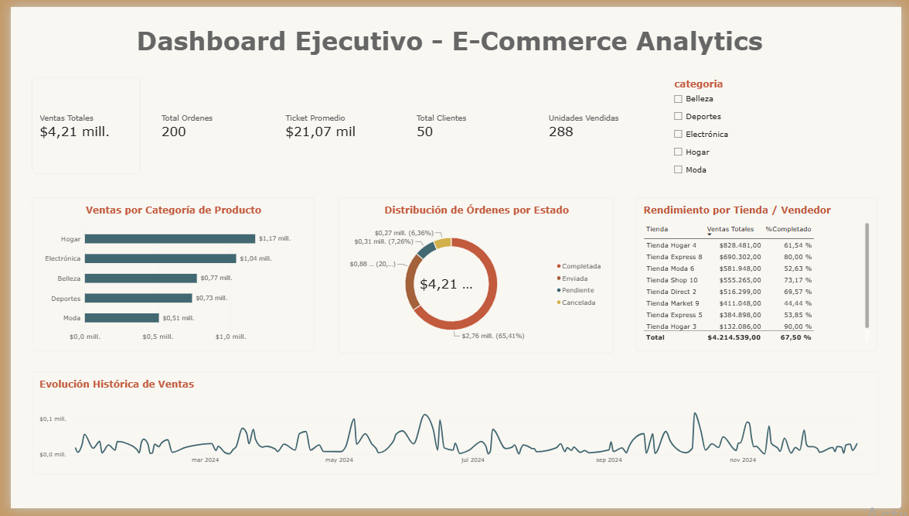

# 📊 E-Commerce Analytics 




---

## 📋 Descripción del Proyecto

Proyecto de analítica de datos end-to-end diseñado para la toma de decisiones ejecutivas en una plataforma de comercio electrónico (E-Commerce). El proyecto abarca todo el flujo de trabajo de ingeniería y análisis de datos: desde la gestión de bases de datos relacionales con **Python** y **SQLite**, la exportación estructurada a archivos CSV, hasta la construcción de un modelo en estrella y un reporte ejecutivo interactivo en **Power BI**.

Este desarrollo permite monitorear el desempeño global del negocio, la efectividad operativa de las órdenes, la contribución por categoría de producto y el rendimiento comercial por tienda o vendedor.

### 🎯 Contexto de Negocio

Como analista de datos, se construyó una solución integral para evaluar el comportamiento transaccional del marketplace. La herramienta centraliza datos transaccionales de ventas, clientes, catálogo de productos y canales de venta, transformando registros crudos en indicadores clave de rendimiento (KPIs) financieros y operativos.

---

## 🎯 Objetivos del Análisis

- ✅ Consolidar datos relacionales transaccionales a través de consultas SQL optimizadas
- ✅ Monitorear métricas financieras clave: Ventas Totales, Ticket Promedio y Unidades Vendidas
- ✅ Analizar la distribución del estado operativo de las órdenes (Completadas, Enviadas, Pendientes, Canceladas)
- ✅ Identificar las categorías de producto con mayor volumen de facturación
- ✅ Evaluar el desempeño de ventas y porcentaje de cumplimiento por tienda/vendedor
- ✅ Analizar la evolución histórica y tendencia temporal de las ventas
- ✅ Proporcionar segmentadores dinámicos para el análisis interactivo de métricas

---

## 👥 Autora

| Nombre | Rol | GitHub | LinkedIn |
|--------|-----|--------|----------|
| **Mariana Moreno** | Data Analyst | [@MarianaMH1195](https://github.com/MarianaMH1195) | [LinkedIn](https://www.linkedin.com/in/mariana-moreno-henao/) |

---

## 🛠️ Metodología de Trabajo

El desarrollo del proyecto se ejecutó en 5 fases secuenciales:

### Fase 1: Extracción y Almacenamiento Relacional (Python & SQLite)
- Creación de la base de datos `marketplace.db`
- Ejecución de scripts de Python para procesamiento y gestión transaccional (`main.py`)

### Fase 2: Consultas SQL y Exportación ETL
- Desarrollo de consultas relacionales complejas (`consultas.py`) uniendo órdenes, clientes y productos
- Exportación estructurada de tablas a archivos CSV (`exportar_csv.py`) para consumo del modelo

### Fase 3: Modelado de Datos en Power BI
- Importación de los archivos CSV al entorno de Power BI
- Diseño de esquema en estrella relacionando la tabla de hechos con tablas de dimensiones

### Fase 4: Cálculo de Métricas con DAX
- Desarrollo de medidas explícitas para KPIs financieros y operativos
- Configuración de formatos monetarios y decimales

### Fase 5: Visualización y Dashboard Ejecutivo
- Maquetación y diseño de interfaz ejecutiva optimizada en Power BI
- Implementación de interacciones cruzadas y filtros por categoría

---

## 📊 Fuentes de Datos

El sistema procesa datos relacionales divididos en las siguientes dimensiones y tablas transaccionales:

| Tabla / Entidad | Archivo | Descripción / Propósito |
|-----------------|---------|-------------------------|
| **Órdenes** | `ordenes.csv` | Registros transaccionales de compras, cantidades, fechas y estados |
| **Clientes** | `clientes.csv` | Información demográfica y maestros de clientes |
| **Productos** | `productos.csv` | Catálogo de productos, precios y categorías |
| **Vendedores** | `vendedores.csv` | Maestro de tiendas y vendedores asignados |
| **Base de Datos** | `marketplace.db` | Base de datos SQLite que consolida la información relacional |

---

## 💻 Tecnologías Utilizadas

### Lenguajes y Entornos
- **Python** - Automatización y gestión del pipeline de datos
- **SQL / SQLite** - Consultas relacionales (JOINs, agrupaciones y filtros)
- **VS Code** - Entorno de desarrollo integrado[cite: 2]

### Visualización y Business Intelligence
- **Microsoft Power BI Desktop** - Modelado de datos en estrella y diseño de dashboards[cite: 2]
- **DAX (Data Analysis Expressions)** - Creación de medidas financieras y métricas dinámicas[cite: 2]


---

## 📁 Estructura del Repositorio

```text
📦 E-Commerce-Analytics/
 ┣ 📁 assets/
 │   ┗ dashboard_preview.png
 ┣ 📁 dashboard/
 │   ┗ Dashboard Ejecutivo.pbix
 ┣ 📁 data/
 │   ┣ clientes.csv
 │   ┣ marketplace.db
 │   ┣ ordenes.csv
 │   ┣ productos.csv
 │   ┗ vendedores.csv
 ┣ 📁 scripts/
 │   ┣ consultas.py
 │   ┣ exportar_csv.py
 │   ┗ main.py
 ┗ 📄 README.md
